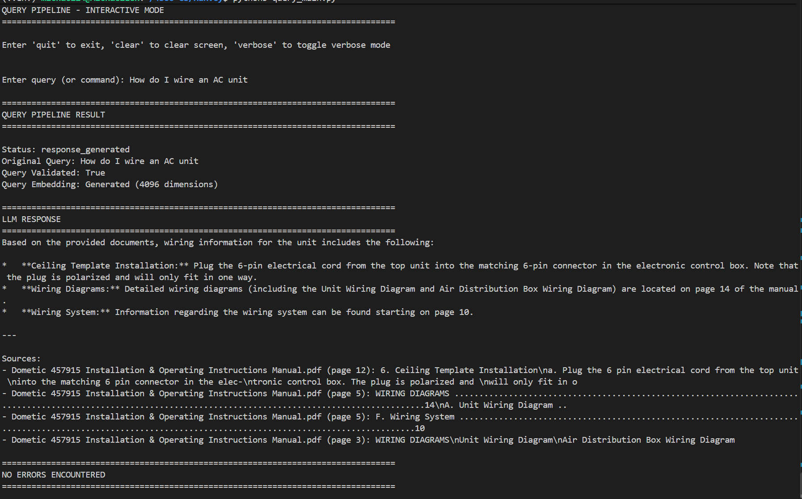

# HaRVey: RV Repair Knowledge Assistant
## Project Plan and Proof-of-Concept Report

## Name Michael Warner
## Git Repo:
## Commit Hash:
---
## 0. What I'm adding to HW-09

### Document: 
add, delete, update, parse tables & diagrams
### Search: 
Add hybrid search to get documents with specific part numbers.
### Tools: 
Display Diagram, Get more context, LLM queries database for more information.
### Knowledge Graph
This is out of scope for this class project but it would be a very cool addition if I continue on with this project.
### Example Output

### Try it yourself
I've committed one trial document in the documents. The README has a detailed explanation but run.
```bash
python ingestion_main.py
```
```bash
python query_main.py
```
Then submit your query. 

## 1. Problem Statement and Context

### Problem
RV technicians and owners need rapid access to accurate repair procedures across numerous RV components and models. Manually searching through fragmented repair manuals is time-consuming and error-prone, leading to delays in repairs and potential safety risks from incorrect procedures.

### Intended User/Client
**Academic/Educational Context:** CS 4300 students learning AI agent design, information retrieval, and LLM integration. The project demonstrates real-world applicability to the RV service industry.

### Intended Use
HaRVey serves as a **semantic search engine for RV repair documentation**. Users (technicians or RV owners) submit natural language queries about repair procedures, component issues, or maintenance tasks, and the system returns:
- Evidence-based answers synthesized from repair manuals
- Direct citations to source documents with page references
- Step-by-step procedures when available

### Target Outcome
**Accuracy and Relevance:** Ensure that retrieved repair procedures are contextually correct and directly address the user's query. The primary success metric is whether the system returns procedures relevant to the technician's specific problem, reducing time spent searching and increasing confidence in following correct procedures.

---

## 2. PEAS Analysis

### Performance Measure
**Retrieval Precision and Recall**
- **Precision:** Of the top-10 documents returned, what percentage are relevant to the query? (Target: ≥80%)
- **Recall:** Of all relevant documents in the corpus, what percentage does the system retrieve? (Target: ≥70%)
- **Secondary Measure:** User satisfaction surveys rating answer quality (1-5 scale)

### Environment
- **Static Components:** Vector database (Chroma) containing RV repair PDF manuals with stable metadata
- **Variable Components:** User queries in natural language, varying specificity and technical depth
- **Constraints:** Limited to documents in the corpus; cannot generate procedures not in manuals
- **Observability:** Query text, database state, retrieval results, LLM responses are fully observable

### Actuators (System Outputs)
1. **Query Response:** Natural language answer synthesized from retrieved documents
2. **Source Citations:** References to original repair manual filenames and extracted passages
3. **Confidence Indication:** Optional confidence level or fallback message when insufficient evidence exists

### Sensors (System Inputs)
1. **User Query:** Text input describing RV component, problem, or maintenance need
2. **Uploaded Documents:** New PDF repair manuals added to the corpus
3. **Vector Database State:** Current collection of embedded documents and their metadata

---

## 3. Agent Design

### Decision Boundary
The system decides whether sufficient relevant information exists in the corpus to answer the query. If confidence is low (retrieval score < threshold or LLM assessment), it signals "insufficient evidence" rather than hallucinating an answer.

### Percepts
1. User query text (semantic content)
2. Retrieved document chunks (relevance scores, metadata)
3. LLM-generated intermediate reasoning
4. Available tool options (respond_to_user, insufficient_evidence)

### Actions
1. **Embed Query:** Convert natural language to vector representation
2. **Search Vector Store:** Retrieve top-10 similar documents by cosine similarity
3. **Generate Response:** Use LLM with ReAct agent to synthesize answer or declare insufficient evidence
4. **Format Output:** Return structured response with citations

### State
- **Persistent State:** Vector database, document embeddings, metadata index
- **Query-Level State:** Query text, embeddings, retrieved chunks, LLM reasoning, final response
- **Tracked via LangGraph:** Each node updates the state object as it progresses

### Goal/Terminal Conditions
- **Success (Terminal):** User receives accurate, cited answer OR explicit indication that corpus lacks relevant information
- **Failure (Terminal):** System returns irrelevant answer (hallucination) or crashes without fallback

### Interaction with Environment
1. User issues query through CLI interface
2. System embeds query and searches vector store
3. LLM reads retrieved context and uses tools to decide on response
4. System returns answer with sources or "insufficient evidence" message
5. Cycle repeats for next query (no persistent user session required)

---

## 4. AI Strategy and Technical Rationale

### Selected Strategy
**Retrieval-Augmented Generation (RAG) + ReAct Agent with Vector Embeddings**

### Why It Fits This Problem

1. **Grounding in Reality:** Vector embeddings + retrieval ensure answers come from actual repair manuals, not LLM hallucinations
2. **Semantic Understanding:** Embedding-based search handles natural language queries better than keyword matching (e.g., "water heater won't ignite" → finds RV water heater repair sections)
3. **Explainability:** Tool calling and source citations allow users to verify answers against original manuals (critical for safety)
4. **Scalability:** Chroma vector store can handle 50+ large PDF documents without latency issues
5. **Flexibility:** ReAct agent can chain reasoning steps if needed (e.g., "find component A, then find procedures for common issues with A")

### Principal Technical Uncertainty
**LLM Response Quality:** Can the LLM reliably synthesize accurate repair procedures from retrieved document chunks, or does it misinterpret technical content or miss important safety warnings?

**What the PoC Must Resolve:**
- Does the LLM correctly understand repair procedure context (e.g., "disconnect battery before servicing" prerequisites)?
- Does it avoid adding information not in the source documents?
- Does it prioritize safety-critical information (warnings, cautions)?
- Can it handle ambiguous queries or distinguish between different RV types/models?

**Testing Approach:** Manual evaluation of 10-15 representative queries with expert review of LLM-generated answers against source documents.

---

## 5. System Diagram

```
┌─────────────────────────────────────────────────────────────────┐
│                         HaRVey System                           │
└─────────────────────────────────────────────────────────────────┘

                       ╔════════════════════════╗
                       ║   User Query (Text)    ║
                       ╚════════════════════════╝
                               │
                               ▼
                    ┌──────────────────────┐
                    │  Query Embedding     │
                    │  (Generate Vector)   │
                    └──────────────────────┘
                               │
                               ▼
                    ┌──────────────────────┐
                    │  Vector Similarity   │
                    │  Search (Chroma)     │
                    │  Top-10 Chunks       │
                    └──────────────────────┘
                               │
                    ┌──────────┴──────────┐
                    ▼                     ▼
          ╔════════════════════╗  ╔════════════════════╗
          ║  Retrieved Chunks  ║  ║  Document Metadata ║
          ║  + Scores          ║  ║  (Filename, etc.)  ║
          ╚════════════════════╝  ╚════════════════════╝
                    │
                    ▼
          ┌─────────────────────────────┐
          │  LLM ReAct Agent            │
          │  ├─ Read Retrieved Context  │
          │  ├─ Reason About Answer     │
          │  └─ Call Tool:              │
          │     • respond_to_user       │
          │     • insufficient_evidence │
          └─────────────────────────────┘
                    │
                    ▼
          ╔════════════════════════════╗
          ║  Formatted Response        ║
          ║  ├─ Answer (Text)          ║
          ║  ├─ Sources (Citations)    ║
          ║  └─ Confidence Level       ║
          ╚════════════════════════════╝

OFFLINE INGESTION (One-time):
  PDFs → Parse → Chunk → Embed → Store in Chroma
```

### Major Components

| Component | Role |
|-----------|------|
| **PDF Parser** | Extract text from repair manuals |
| **Text Chunker** | Split into 512-char chunks (50-char overlap) for embeddings |
| **Embedding Service** | Convert text to vectors (Qwen3-Embedding-8B) |
| **Chroma Vector Store** | Persistent indexed storage for similarity search |
| **LLM (Qwen3.8-27B)** | Synthesize answers with ReAct reasoning |
| **Query Pipeline** | Orchestrate embedding → search → LLM → format |

### Information Flow
1. **Ingestion (Offline):** Documents → Parse → Chunk → Embed → Store
2. **Query (Online):** User Query → Embed → Search → LLM Reason → Respond

---

## 6. Three-Week Implementation Plan

### Week 1: Foundation & Ingestion Validation
**Goal:** Verify PDF ingestion pipeline and embedding quality

- **Day 1-2:** Environment setup, dependency installation, .env configuration
- **Day 3-4:** Verify ingestion pipeline with test PDFs
  - Test PDF parsing with diverse manual formats
  - Verify embeddings are generated correctly
  - Confirm Chroma storage and persistence
- **Day 5:** Create test dataset (5-10 sample queries with expected answer chunks)

**Deliverable:** Working ingestion pipeline, 50+ RV manuals embedded in Chroma

### Week 2: Query Pipeline & Agent Refinement
**Goal:** Build and test end-to-end query system with LLM response generation

- **Day 6-7:** Implement query embedding and vector search
  - Test semantic similarity with manual queries
  - Measure retrieval precision/recall on test dataset
- **Day 8-9:** Integrate LLM with ReAct agent and tool calling
  - Implement respond_to_user and insufficient_evidence tools
  - Test answer synthesis from retrieved chunks
- **Day 10:** Manual quality evaluation
  - Run 15 representative queries
  - Expert review of LLM answers vs. source documents
  - Identify failure modes (hallucinations, missed context, etc.)

**Deliverable:** Working query pipeline, initial LLM response quality assessment, identified refinements

### Week 3: Evaluation, Optimization & Documentation
**Goal:** Finalize evaluation framework, optimize response quality, prepare presentation

- **Day 11-12:** Implement numeric evaluation metrics
  - Measure retrieval precision/recall on 20+ test queries
  - Track LLM answer accuracy on domain-specific questions
  - Document failure cases
- **Day 13-14:** Optimize based on findings
  - Refine chunking strategy if retrieval is poor
  - Adjust LLM prompts if synthesis is inaccurate
  - Improve metadata indexing if relevant docs are missed
- **Day 15:** Final integration test and prepare documentation

**Deliverable:** Evaluation results, optimization report, system performance metrics

### Week 4: Final Documentation & Presentation
- Create system architecture documentation
- Prepare presentation slides
- Write deployment guide and limitations report

---

## 7. Evaluation Plan

### Repeatable Evaluation Methodology

#### Phase 1: Retrieval Quality (Vector Search)
**Inputs:** 20 test queries with known relevant documents  
**Metric:** Precision@10 and Recall@10

```
Precision@10 = (# relevant docs in top-10) / 10
Recall@10 = (# relevant docs in top-10) / (total relevant docs in corpus)
Target: Precision ≥80%, Recall ≥70%
```

**Process:**
1. Create benchmark queries from repair manual tables of contents
2. Manually identify relevant source chunks for each query
3. Run query through vector search, record top-10 results
4. Compare retrieved chunks against benchmark
5. Calculate metrics

#### Phase 2: LLM Response Quality (End-to-End)
**Inputs:** 15 representative repair queries  
**Metric:** Answer accuracy, hallucination rate, citation correctness

| Metric | Method | Target |
|--------|--------|--------|
| **Factual Accuracy** | Expert review: Does answer match source docs? | ≥85% correct |
| **Hallucination Rate** | % of answers containing info NOT in sources | <10% |
| **Source Citation Accuracy** | Are cited chunks relevant to answer? | ≥90% relevant |
| **Safety Compliance** | Are warnings/cautions preserved? | 100% for critical items |

**Grading Rubric:**
- **Excellent (5):** Accurate, well-cited, comprehensive, no hallucinations
- **Good (4):** Minor omissions or unclear citations
- **Acceptable (3):** Mostly correct but some hallucinations or weak citations
- **Poor (2):** Significant errors or missing critical info
- **Unacceptable (1):** Dangerous misinformation

#### Phase 3: System Reliability
**Metric:** Uptime, latency, error rate

```
- Query latency (embed + search + LLM): < 5 seconds (target)
- Error recovery rate: 100% (graceful fallback)
- Pipeline failure rate: < 1% over 100 queries
```

### Evaluation Timeline
- **End of Week 2:** Preliminary LLM quality assessment (10 queries)
- **End of Week 3:** Final comprehensive evaluation (20 retrieval + 15 LLM queries)
- **Reporting:** Detailed metrics with pass/fail against targets

---

## 8. Expected Limitations and Failure Conditions

### Inherent Limitations

1. **Corpus Dependency:** System can only answer questions about topics covered in uploaded repair manuals. RV types or components not in documents → "insufficient evidence"

2. **LLM Hallucination Risk:** Despite RAG grounding, LLM may still:
   - Invent procedural details not in source
   - Misunderstand technical jargon
   - Conflate procedures from different RV types

3. **Chunking Trade-offs:**
   - Small chunks (512 chars) may lose context
   - Large chunks may dilute retrieval signal
   - Optimal size may vary by document type

4. **Semantic Ambiguity:** Queries like "water system issue" are ambiguous (heating? plumbing? pressure?). System may retrieve mismatched results

5. **Scalability:** Ingestion pipeline may slow with 200+ large PDFs or require optimization

### Critical Failure Conditions

| Failure Condition | Impact | Mitigation |
|---|---|---|
| **Provides unsafe repair procedures** | Safety hazard; potential legal liability | Mandatory expert review before deployment; add safety warning filter |
| **Cannot find relevant manuals** (Recall <50%) | System unhelpful; users abandon it | Improve embedding model or chunk strategy; add keyword search fallback |
| **Frequent hallucinations** (>15% of answers) | Users lose trust; incorrect repairs occur | Stricter confidence thresholds; mandatory citation validation |
| **System crashes during queries** | Complete downtime; users unable to access help | Comprehensive error handling; fallback responses |

### Criteria for Deployment Recommendation

#### ✅ **DEPLOY** if:
- Retrieval Precision ≥80% AND Recall ≥70%
- LLM accuracy ≥85% with <10% hallucination rate
- 100% safety compliance (no missed warnings)
- Latency <5 seconds, <1% error rate
- Expert review approves representative queries

#### ⚠️ **REVISE & RETEST** if:
- Retrieval metrics 70-80% (improve chunking/embedding)
- LLM accuracy 75-85% (refine prompts, add safety filters)
- Hallucination rate 10-15% (add confidence thresholds)
- Latency 5-10 seconds (optimize infrastructure)
- Specific failure modes identified (retarget evaluation)

#### ❌ **DO NOT USE** if:
- Retrieval Precision <70% or Recall <60%
- LLM accuracy <75% or hallucination rate >15%
- Safety compliance failures or missed critical warnings
- Latency >10 seconds or error rate >5%
- Expert review flags unresolvable flaws

---

## Conclusion

HaRVey demonstrates how RAG + agent architectures can solve real-world information retrieval problems. The three-week PoC focuses on resolving the key uncertainty (LLM response quality) through rigorous evaluation and expert validation, ensuring a foundation for safe, trustworthy deployment in RV service contexts.

**Next Steps:**
1. Finalize test dataset with domain expert (RV technician) input
2. Begin Week 1 ingestion pipeline validation
3. Weekly review of evaluation metrics against targets
4. Decision gate at end of Week 3 on deployment readiness
